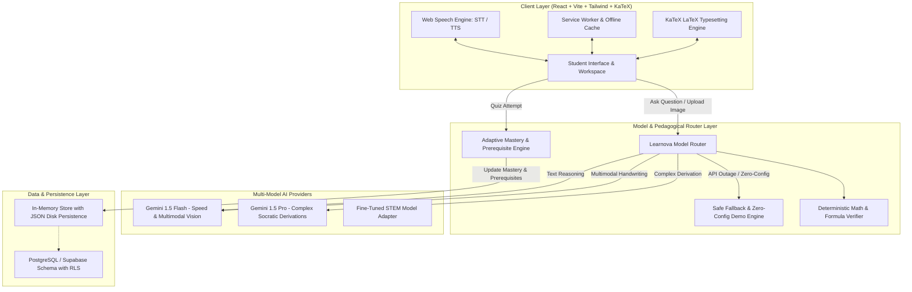

# Learnova AI — System Architecture & Technical Design

## 1. Executive Summary

**Learnova AI** is an AI-powered Socratic learning companion designed for school children in Grades 6–12 studying **Mathematics, Physics, and Chemistry**. Rather than acting as a superficial homework solver, Learnova AI enforces structured pedagogical reasoning, multimodal handwriting recognition, observable adaptive learning loops, and multilingual accessibility (English, Telugu, Hindi).

---

## 2. System Architecture Diagram

---

## 3. Layer Breakdown

### A. Frontend Client Layer
- **Framework:** React 18 + TypeScript + Vite + Tailwind CSS.
- **Pedagogical Typography:** KaTeX math typesetting rendering mathematical expressions, physical units ($m/s^2$, $\Omega$), and chemical equations ($Fe_3O_4$).
- **Voice System:** Integrated browser Web Speech API providing speech-to-text question input and speech synthesis audio explanations with language-aware accents.
- **Offline & Low-Bandwidth Mode:** Progressive Web App (PWA) manifest and service worker caching static shells, formula reference sheets, and saved student notes.

### B. Model Router & Pedagogical Abstraction
- **Dynamic Routing:** Directs image and handwriting tasks to vision-capable multimodal models and text tasks to high-speed models.
- **Structured 9-Part Pedagogical Schema:**
  1. Problem intent & decomposition
  2. Core concepts required
  3. Step-by-step reasoning with LaTeX formulas
  4. Final verified answer
  5. Conceptual justification ("Why method works")
  6. Real-world analogy
  7. Common student pitfall to avoid
  8. Interactive check-your-understanding question
  9. Recommended next topic
- **Deterministic Math Verifier:** Independent arithmetic, discriminant ($D = b^2 - 4ac$), and Ohm's law ($V = IR$) verification.
- **Safe Fallback:** If API quotas are reached or no API key is configured, Learnova seamlessly switches to the built-in Socratic Demo Engine, clearly indicating demonstration mode.

### C. Observable Adaptive Mastery Engine
- **Formula:** Weighted exponential moving average:
  $$\text{Mastery}_{t} = 0.6 \times \text{Mastery}_{t-1} + 0.4 \times \text{Accuracy}_{\text{quiz}}$$
- **Thresholds:**
  - $\ge 0.85 \implies$ **Mastered** (advances syllabus to next topic)
  - $< 0.60$ or $\ge 2$ mistakes $\implies$ **Needs Revision** (triggers targeted prerequisite lesson)
  - Otherwise $\implies$ **In Progress**
- **Explainability:** Transparent reasons are attached to every recommended roadmap node.

### D. Child Safety & Security Guardrails
- **Minimal PII Collection:** Collects only grade and preferred learning style.
- **Content Filtering:** Strict prompt restrictions blocking dangerous chemical recipes, explosives, or harmful content.
- **Server-Side API Key Storage:** API secrets are stored strictly on the server and never exposed to the client.
